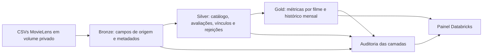

# MediaLens Lakehouse

Pipeline de engenharia de dados e painel analítico de filmes com **33.832.162 avaliações do MovieLens**. O projeto roda em batch no Databricks Free Edition com Lakeflow Spark Declarative Pipelines, SQL, Delta Lake e AI/BI Dashboards.

A edição de **20/07/2023** reúne avaliações de 1995 a 2023. Cada evento tem filme, nota de 0,5 a 5 estrelas e horário da avaliação. O painel usa esse horário para mostrar como a nota de um mesmo filme mudou ao longo do tempo.

## Painel

| Página | Pergunta |
| --- | --- |
| Catálogo e gêneros | Quais gêneros concentram mais avaliações e quais filmes têm as maiores notas entre os que receberam pelo menos 100 avaliações? |
| Histórico por filme | Como a nota acumulada evoluiu e quantas avaliações o filme recebeu em cada mês? |
| Qualidade das camadas | Quantas linhas entraram, foram consolidadas ou rejeitadas, e quantos eventos chegaram às duas saídas Gold? |

A visualização de **Toy Story (1995)** ilustra o histórico de 1996 a 2023, com **76.813 avaliações**. O ano de lançamento identifica o filme no catálogo. A série começa na primeira avaliação disponível. [Guia do painel](docs/dashboard.md)

## Arquitetura

A Silver preserva homônimos pelo ID MovieLens, consolida duplicatas exatas e registra conflitos e rejeições. A Gold reconcilia a contagem de eventos por filme e por mês com a Silver. O vínculo IMDb vem dos IDs externos do MovieLens e mantém candidatos ambíguos. [Modelo de dados](docs/data-model.md) · [Definição das métricas](docs/metrics.md)

## Como executar

1. Autentique o CLI com o perfil `medialens-dev`. [Conexão ao Databricks](docs/databricks-connection.md)
2. Crie os schemas, publique o volume e o pipeline, carregue os CSVs e execute a primeira atualização. [Guia MovieLens](docs/movielens.md)
3. Publique o painel com o ID do seu SQL warehouse. [Guia do painel](docs/dashboard.md)
4. Rode a suíte com dados sintéticos para verificar as transformações e simular falhas de qualidade. [Testes](tests/README.md)

## Fonte

MovieLens Latest Full, GroupLens Research. Cite Harper e Konstan (2015), *The MovieLens Datasets: History and Context*. Os CSVs e IDs de usuários ficam no ambiente privado. [Documentação e licença da edição](https://files.grouplens.org/datasets/movielens/ml-latest-README.html) · [Citação](https://doi.org/10.1145/2827872)
