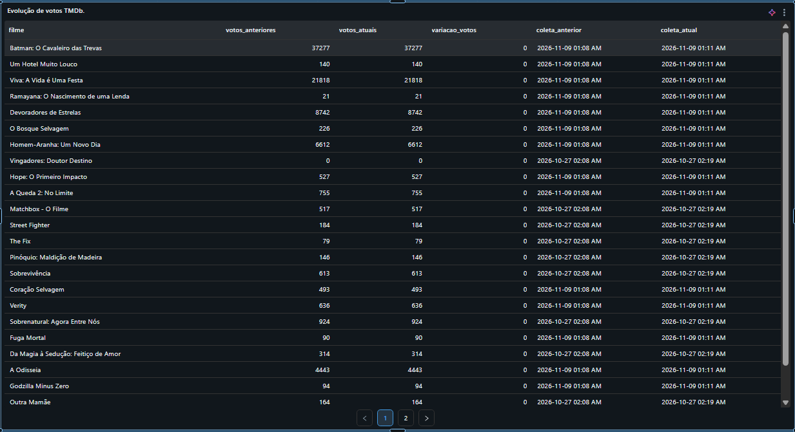
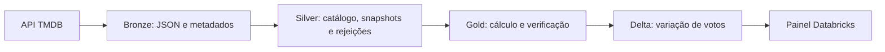

# MediaLens Lakehouse

Pipeline de dados em batch que coleta filmes populares da TMDB e mostra **quanto a contagem de votos mudou entre as duas últimas coletas de cada filme**. O projeto roda no Databricks Free Edition com Python, PySpark, SQL, Delta Lake e Lakeflow Jobs.

Na demonstração, o job executou **Bronze → Silver → Gold** e o painel usou uma Gold com **33 linhas, 33 filmes distintos e 33 pares com contagens comparáveis**. Esses números registram uma execução, pois o catálogo de filmes populares muda com o tempo. As regras automáticas de qualidade e de reprocessamento foram adicionadas depois dessa demonstração e têm testes locais.



A métrica é uma diferença absoluta. Leia a variação junto com as datas, já que o intervalo pode mudar por filme. Zero indica que o total ficou igual entre as duas coletas. A amostra representa o recorte de filmes populares retornado pela API.

## Arquitetura



| Camada | Tabelas Delta | Grão e comportamento |
| --- | --- | --- |
| Bronze | `workspace.medialens_bronze.tmdb_api_responses` | Uma linha por lote e página. Guarda JSON, hora UTC, origem, endpoint e parâmetros sem credenciais. |
| Silver | `workspace.medialens_silver.tmdb_movies` | Uma linha por fonte e ID do filme, com os dados válidos mais recentes. |
| Silver | `workspace.medialens_silver.tmdb_rating_snapshots` | Uma linha por filme, fonte e coleta. Guarda nota original, escala, votos e horário. |
| Silver | `workspace.medialens_silver.tmdb_rejects` | Registros rejeitados com motivo e referência à carga Bronze. |
| Gold | `workspace.medialens_gold.tmdb_vote_changes` | Uma linha por filme e fonte com pelo menos duas coletas. Guarda a diferença de votos e os IDs e horários das duas observações. |

O job `tmdb_bronze_ingestion` executa as três camadas em sequência. A Bronze usa o ID da execução do Lakeflow Jobs para reaproveitar o lote confirmado em um reparo. Uma nova execução cria uma nova observação. A Silver reconstrói suas tabelas a partir de uma versão Delta da Bronze. A Gold confere unicidade, cobertura e cálculo antes de substituir a tabela usada pelo painel.

## Como executar

Pré-requisitos: [CLI autenticado com o perfil `medialens-dev`](docs/databricks-connection.md), compute serverless, acesso de escrita no catálogo `workspace` e token TMDB no segredo `medialens-api/tmdb-read-token`.

**1. Publique e execute o job TMDB primeiro.** Na raiz do projeto, use o PowerShell:

```powershell
databricks bundle validate -t dev --profile medialens-dev
databricks bundle deploy -t dev --profile medialens-dev --select jobs.tmdb_bronze_ingestion
databricks bundle run tmdb_bronze_ingestion -t dev --profile medialens-dev
```

Espere as três tarefas terminarem. O job cria os schemas Bronze, Silver e Gold e as tabelas TMDB que o MovieLens usa. O padrão é coletar uma página por execução. A tabela de variação de votos fica vazia até haver um filme com duas coletas válidas. Se alguma tarefa falhar, siga o [procedimento de reparo](docs/bronze-tmdb.md#reparar-uma-execução).

```sql
SELECT title, previous_observed_at, current_observed_at,
       previous_vote_count, current_vote_count, vote_count_change
FROM workspace.medialens_gold.tmdb_vote_changes
ORDER BY vote_count_change DESC NULLS LAST, title;
```

**2. Instale o MovieLens.** Com a Silver da TMDB pronta, siga o [guia MovieLens](docs/movielens.md#executar) para publicar o volume e o pipeline, carregar os três CSVs e executar a carga. O volume precisa do schema Bronze criado na etapa anterior.

## Testes locais

Os testes usam dados sintéticos, HTTP simulado e SQLite para exercitar a lógica SQL. Rodam sem conta Databricks e sem segredos. No PowerShell:

```powershell
$env:PYTHONPATH = "src"
python -m unittest discover -s tests -v
```

O workflow de CI executa a mesma suíte no GitHub Actions. A execução no workspace continua sendo necessária para validar o ambiente serverless, a escrita em Delta e as permissões.

## Repositório

- `src/medialens/` contém a coleta HTTP, as transformações e a métrica.
- `notebooks/` contém os pontos de entrada das tarefas no Databricks.
- `resources/` declara o job e as dependências no bundle.
- `tests/` contém os testes locais com dados sintéticos.
- [Arquitetura e recuperação](docs/architecture.md), [modelo](docs/data-model.md) e [métrica](docs/metrics.md).

## Integração MovieLens

O bundle também define um pipeline Lakeflow para a edição MovieLens Latest Full de 2023-07-20. Ele processa catálogo, avaliações e vínculos em três camadas, preserva os dois provedores e mostra a cobertura do cruzamento por ID. Veja o [guia de carga, execução e conferência](docs/movielens.md).

Na primeira execução, foram reconciliadas **33.832.162 avaliações** entre Bronze, Silver e Gold, sem rejeições. A Gold agregou **83.239 filmes** do MovieLens. No recorte TMDB daquela execução, **3 de 33 filmes** tinham correspondência confirmada com avaliações MovieLens.

### O que muda nos dados em cada camada

| Camada | Exemplo com *Toy Story* (`movie_id = 1`) |
| --- | --- |
| Bronze | Preserva cada linha do CSV, com IDs, nota e timestamp em texto, além do arquivo de origem. |
| Silver | Converte os IDs para inteiros, a nota para decimal e o horário para timestamp. Valida a escala de 0,5 a 5, consolida cópias exatas e separa eventos inválidos ou conflitantes. |
| Gold | Resume todas as avaliações válidas em uma linha por filme e edição, com média, contagem e datas da primeira e da última avaliação. |

A Bronze e a Silver tiveram a mesma contagem porque essa edição passou pelas regras sem rejeições ou cópias exatas. A mudança está no formato e na validação dos eventos. Na Gold, **83.239** é a contagem de filmes e **33.832.162** é a soma das avaliações desses filmes.

A auditoria `workspace.medialens_gold.movielens_quality` verifica os totais e o grão da cobertura a cada atualização. O [guia de operação](docs/operacao-movielens.md) traz as consultas para o painel e o procedimento para investigar falhas.

## Próxima evolução

Coletar snapshots em dias diferentes com a TMDB para aumentar a profundidade do histórico. No MovieLens, medir a cobertura do cruzamento e o custo do primeiro processamento completo. Os dois fluxos rodam em batch. Veja [decisões técnicas](docs/decisions.md).

## Créditos

Dados do painel fornecidos pela [TMDB](https://www.themoviedb.org/).

> This product uses the TMDB API but is not endorsed or certified by TMDB.

Consulte [fontes e condições de uso](docs/data-sources.md) antes de compartilhar o painel publicamente ou ampliar a coleta.
