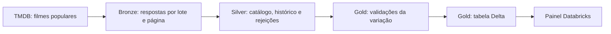

# Arquitetura e operação

O fluxo TMDB é um **Lakeflow Job em batch** gerenciado pelo bundle. As tarefas usam serverless no Databricks Free Edition. O YAML controla a ordem e os parâmetros. Os notebooks chamam a lógica Python, PySpark e SQL de `src/medialens/`.

O [fluxo MovieLens](movielens.md) usa um pipeline declarativo separado. Lê CSVs de um volume privado, materializa as três camadas em batch e cruza a Gold com o catálogo e os snapshots Silver da TMDB por ID.

## Reprocessamento

- **Bronze.** O ID `job_<run_id>` é estável dentro da execução do job. O lote inteiro é coletado antes do `MERGE`, que insere pela chave `run_id, page`. Se o lote estiver confirmado, o reparo reaproveita os registros. O job aceita uma execução por vez. Execuções antigas com IDs UUID continuam válidas.
- **Silver.** Lê uma versão Delta fixa da Bronze e recria as três tabelas. Cada gravação é atômica por tabela. Uma falha no meio da tarefa pode deixar as tabelas temporariamente em momentos diferentes. Repare a Silver antes de atualizar a Gold.
- **Gold.** Fixa a versão de cada entrada Silver, calcula a tabela candidata e confere as regras antes da substituição Delta. A Gold anterior permanece disponível se a validação reprovar a candidata. Mantenha um único escritor para essas tabelas por ambiente.

## Como investigar

| Sintoma | Onde olhar | Ação |
| --- | --- | --- |
| Falha na Bronze | Saída da tarefa e código HTTP | Confirme o segredo em 401/403. Para 429 ou 5xx, revise o intervalo e o limite de tentativas. |
| Houve rejeições | `tmdb_rejects` agrupada por `rejection_reason` | Localize o JSON original por `run_id` e `page` antes de ajustar o contrato. |
| Falha na Gold | Mensagem com linhas esperadas, duplicadas e inválidas | Compare a cobertura dos snapshots, investigue o erro e repare a tarefa. |
| Painel sem linhas | Contagem de coletas por filme na Silver | A Gold precisa de duas observações por filme. Confirme a cobertura da amostra. |

O fluxo atual é manual. Uma nova execução completa pode coletar um novo lote mesmo quando o conteúdo da API continua igual. Use o reparo da execução original para recuperar uma tarefa. A cada execução, o Databricks registra duração e estado por tarefa. Os notebooks também mostram contagens de saída e, na Gold, o resumo de validação.
